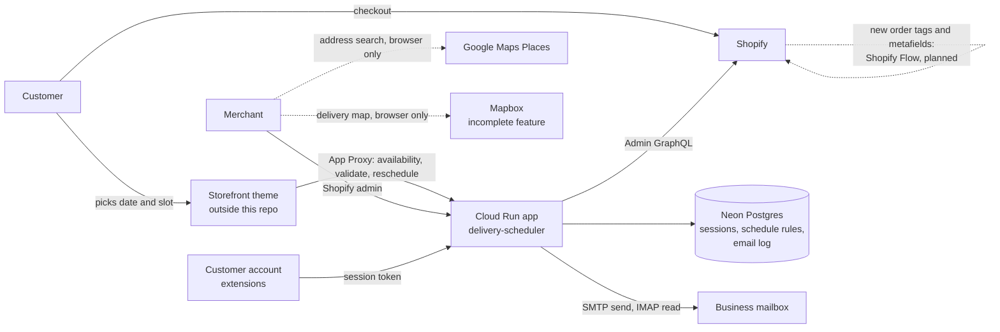

# Architecture

How the delivery-scheduler app works. This page was rewritten on 2026-10-23 from the source code, not from the older version of this file. Where it says "see" a path, that file is the proof. Read [runbook.md](runbook.md) to operate it and [../gcp-inventory.md](../gcp-inventory.md) for the cloud resources.

## Read this first: what is not final yet
These are the places where the code, Shopify and this page can disagree. Check them before you trust a statement.

| What | State on 2026-10-23 |
|---|---|
| **`orders/create` webhook** | **Removed from the code and from `shopify.app.production.toml`, but not deployed.** Until `npm run deploy:prod` runs, Shopify still delivers it to the live app, which no longer has the route. The merchant plans to write the schedule tags with Shopify Flow instead. Flow is not set up as far as this repo can tell. Deploy only after Flow writes the same tags and metafields (see "How delivery information is stored on an order"). |
| **Delivery map on the Orders page (Mapbox)** | **Incomplete feature.** It is built and tested but not yet seen in a real browser, and `MAPBOX_PUBLIC_TOKEN` is not set on Cloud Run. See "Delivery map (incomplete)". |
| **Uncommitted work** | The map, the removal of `orders/create` and the `package.json` change are in the working tree and not committed. |

## What it is
A Shopify embedded app for one merchant, The Flowercart (Metro Manila). It does three jobs:

1. **Delivery scheduling.** Customers pick a delivery date and time slot. The app holds the rules (cutoff hour, preparation time, booking window, time slots, blocked dates, optional capacity per slot) and tells the storefront which dates and slots can be booked.
2. **Order operations.** A workspace in the Shopify admin (`/app/orders`) where the merchant sees orders by delivery day, sees them on a map, reschedules, tags, fulfils, cancels, edits the shipping address and emails customers.
3. **Checkout and account helpers.** Delivery information on the thank-you page, the customer order status page, the customer account and the admin order page.

It is built on React Router 7, `@shopify/shopify-app-react-router`, Polaris web components (Polaris 2.0, loaded from `app/lib/polaris-url.ts`), Prisma with Postgres, and runs on Google Cloud Run (`app/shopify.server.js`: API version April 2026, single-merchant distribution).

## The main idea
**The Shopify order is the source of truth.** The app writes the delivery information onto the order and reads it back from there. Postgres holds only three tables: `Session`, `DeliveryScheduleConfig` and `EmailSendLog` (`prisma/schema.prisma`).



### How delivery information is stored on an order
| Where | Name | Written by | Read by |
|---|---|---|---|
| Checkout attribute | `Delivery Date`, `Delivery Time` | the storefront picker at checkout; kept in step by every reschedule | Orders page (fallback), extensions |
| Metafield | `custom.date`, `custom.time_slot` | reschedule (`reschedule-order-delivery.server.ts`, bulk reschedule); **nothing writes them for a new order once `orders/create` is gone** | everything: Orders page, booked counts (`delivery-bookings.server.ts`), customer extensions |
| Metafield | `delivery.date`, `delivery.time_slot`, `sidekick.delivery_date` | mirrors of the canonical values, written together with them | older readers |
| Metafield | `delivery.sync_status` | only the removed `orders/create` flow wrote it (`ok` or `attention:<code>`); nothing reads it now | none |
| Metafield | `$app.reschedule_status`, `$app.reschedule_requested_at`, `delivery.reschedule_history` | reschedule | Orders page, customer extensions |
| Metafield | `$app.reschedule_seen_at`, `$app.email_reply_seen_at` | the Orders page "Seen" buttons | the bell and banner |
| Shop metafield | `$app.quick_replies` | the Scheduler page | the email modals |
| Tag | bare date `2026-10-03` and bare slot `9AM-12PM` | reschedule; **a new order only gets them from Shopify Flow** | Orders page tabs, date filter and search; the merchant's own automations |
| Tag | `resched` | reschedule | closes the one self-service reschedule |
| Tag | event tags `resched-<date>`, `addr-<date>`, `tracked-<date>` | reschedule, Edit details, Mark fulfilled | merchant timeline, dated by the shop-local day |

Tags are capped at 40 characters. `app/lib/order-tags.ts` owns the tag vocabulary. If a new order has no `custom.date` metafield, the Orders page still finds its date from the checkout attribute and then from a bare-date tag (`getDeliveryDateValue` in `app/lib/order-utils.ts`), but booked counts and the storefront rules only look at `custom.date`.

## Flows

### 1. A new order arrives
**Nothing in this app handles it after the `orders/create` removal is deployed.** Until then, the live app still runs the old route. The old route, deleted from the code on 2026-10-23, did four things: read `Delivery Date` and `Delivery Time` from the order, judged the choice against the cutoff and capacity (`delivery.sync_status`), wrote the metafields and replaced the schedule tags, and answered `500` on a failed step so Shopify redelivered. The Flow that replaces it should write the same tags and `custom.date` / `custom.time_slot`. It cannot reproduce the cutoff and capacity check, so `attention:*` flags stop.

### 2. The storefront asks what can be booked
The theme's date picker calls the **app proxy** (`/apps/schedule-rules`, set in the toml), which Shopify forwards with a signed query string (`app/lib/verify-app-proxy.server.ts`).
- `GET /apps/schedule-rules` (`apps.schedule-rules.ts`): the availability window, each upcoming date and slot with whether it can be booked, plus the cutoff.
- `/apps/schedule-rules/validate`: checks one date and slot.
- `POST /apps/schedule-rules/reschedule`: a logged-in customer reschedules their own order from the storefront.
- `/apps/schedule-rules/coverage?q=`: the delivery fee checker block (area lookup in `app/data/ncr-zipcodes.ts`).
- `/apps/schedule-rules/products`: pages through a collection with the Storefront API.
The picker itself is part of the merchant's theme, outside this repository.

### 3. A customer reschedules
Two entry points write the same result:
- the customer account extension `delivery-reschedule-customer`, through `routes/public.customer-account.reschedule.ts` (session token checked with `jose`);
- the storefront, through `apps.schedule-rules.reschedule.ts` (the customer is the `logged_in_customer_id` Shopify adds to the signed request).
Both check the customer owns the order and it is still reschedulable (not fulfilled, no `resched` tag), validate the new date and slot, then write metafields, attributes and tags. `services/reschedule-order-delivery.server.ts` is the shared write sequence: canonical metafields, history, attribute mirror, then tags.

### 4. The merchant works the day
`/app/orders` (`routes/app.orders.tsx`, the biggest file in the app).
- **Loader:** queries orders (tab, delivery-date tag, search, sort, cursor paging), works out the shop-local "today", loads email-send history from Postgres and recent reschedules for the banner. The time-slot filter runs in the browser.
- **Action:** one POST endpoint dispatched on `_action`: `sendEmail`, `markRescheduleSeen`, `markEmailReplySeen`, `editDetails`, and the bulk actions `archive`, `unarchive`, `cancel`, `tagsAdd`, `tagsRemove`, `markFulfilled`, `markAsPaid`, `reschedule` (`services/bulk-actions.server.ts`, at most 10 orders, run one by one inside the request; each is safe to run twice).
- **Screen:** `OrdersIndexTable`, `OrderDetailsPanel` (one order with a timeline), the delivery map, and a modal per action. `hooks/useSmartRefresh.ts` reloads the data every 20 minutes and pauses while a modal is open.
- **Side routes** (kept out of the loader so they cannot slow it): `app.orders_.inbox.ts` (the bell), `app.orders_.email-thread.ts` (one order's emails), `app.orders_.reschedule-rules.ts` (rules for the reschedule modal).

### 5. The merchant edits the rules
`/app/scheduler` (`routes/app.scheduler.tsx`) is the only place the rules change. Each change is a small operation handled by `services/scheduler-ops.server.ts`, saved through `services/schedule-rules.server.ts`. Every write carries the `version` the page loaded; if someone else saved first the answer is `stale_config` and the page reloads. Booked counts come from `services/delivery-bookings.server.ts` (one Admin search by `custom.date`, cached briefly in memory). Quick replies save through `app.scheduler_.quick-replies.ts`. `app.schedule-rules.tsx` only redirects the old URL here.

### 6. Email
- **Send:** `services/send-customer-email.server.ts` (nodemailer, SMTP) sends from the business mailbox, copies the sender, supports up to 3 photos, and logs a row in `EmailSendLog`. The merchant-reschedule notice is `services/reschedule-notice.server.ts`.
- **Read:** `services/customer-inbox.server.ts` (imapflow) opens the same mailbox read-only during a request (Orders page load, Refresh, the bell, an order panel). No background connection. Replies are matched to orders by order number in the subject and the customer address.
- **State:** seen markers are order metafields and quick replies a shop metafield; only the send log is in Postgres.

### 7. Edit details
`services/update-order-contact.server.ts` rewrites the shipping address and receiver phone through `orderUpdate` and adds the `addr-<date>` event tag. The address search in the modal uses Google Places in the browser (`lib/google-places.client.ts`, key `GOOGLE_MAPS_API_KEY`).

## Delivery map (incomplete)
A map above the Orders table (`components/orders/DispatchMap.tsx`). It is only a picture of the list the table already shows: `displayedOrders` in `app.orders.tsx` is passed through `lib/dispatch-map.ts`. It reads orders and writes **nothing** to Shopify or Postgres; `test/dispatch-map-guard.test.ts` fails if a map file imports server code or tag logic, or can write to an order.

**How it works**
- **Position of a pin.** Shopify's own `shippingAddress.latitude/longitude` first (read-only fields added to the Orders query). If Shopify has none, the browser asks Mapbox Geocoding v6 (`lib/dispatch-geocode.ts`: Philippines only, biased to Metro Manila, 4 lookups at a time, answers kept in memory for the visit, a failed connection retried once). A partial match is drawn with an amber "!" and a short note.
- **Pin popup.** One small line: name, address, date `MM-DD-YYYY`, time, items, price, and a trash button at the bottom. Empty parts are left out. The trash only hides the pin until the page reloads or Restore is pressed.
- **Route.** "Optimize route" orders the stops as a round trip from the hub (`lib/dispatch-route.ts`: nearest neighbour, then 2-opt) and draws a road line from Mapbox Directions (`lib/dispatch-directions.ts`, up to 25 points, otherwise a straight line).
- **Loading.** `mapbox-gl` is imported inside an effect, so it is not in the server build or the first page load. The map zooms by itself only when the set of orders changes, never on a refresh or when a pin is removed.
- **Config.** `MAPBOX_PUBLIC_TOKEN` (a public `pk.` token with URL restrictions), read in the Orders loader. Without it the map shows a one-line note.

**What is not done**
- Not yet checked in a real browser with a token, and not deployed.
- `MAPBOX_PUBLIC_TOKEN` is not set on Cloud Run.
- The hub position (`DISPATCH_HUB` in `lib/dispatch-route.ts`) is the value from the earlier prototype; confirm it is the real start address.
- No clustering of pins that sit at the same place.
- No dispatch status, rider, drivers, share route or inventory. They were dropped from this change on purpose; if added later, store them with a Prisma migration and keep the map readable when that storage is down.

## The scheduling rules
`app/lib/delivery-availability.ts` is the rules engine, used by the server and the extensions.
- **Rules:** timezone, same-day cutoff hour, preparation hours, booking window in days, the slots (`display` and a frozen `value` such as `9AM-12PM`), blocked dates, blocked slots per date, and optional capacity per date and slot.
- **A slot is bookable** when the date is inside the window, not blocked, after the cutoff and preparation time, and (for capacity) not full.
- `lib/schedule-rules-schema.ts` validates writes strictly and reads stored rules leniently, reporting any repair as a health issue.
- `lib/slot-value.ts` decides that `9am - 12pm` and `9AM-12PM` are the same slot; nothing rewrites a stored value. `lib/slot-times.ts` parses and builds slot values.
- Defaults until a row exists: Asia/Manila, 5 PM cutoff, 1 hour preparation, 25 days, four slots (9AM-12PM, 12PM-3PM, 3PM-6PM, 6PM-11PM).

## Trust boundaries
| Caller | Routes | How it is verified |
|---|---|---|
| Merchant in the Shopify admin | `app.*`, `auth.*` | Shopify session token (`authenticate.admin`) |
| Shopify webhooks | `webhooks.app.uninstalled`, `webhooks.app.scopes_update` | webhook HMAC (`authenticate.webhook`) |
| Storefront through the app proxy | `apps.schedule-rules.*` | app proxy signature (`authenticate.public.appProxy` and `lib/verify-app-proxy.server.ts`) |
| Customer account extensions | `public.customer-account.*` | customer session token checked with `jose` and the app secret, then `unauthenticated.admin`; CORS limited to Shopify's extension origin |
No endpoint relies on a secret of its own. Customer email addresses are always read from Shopify, never from a request. The Mapbox and Google keys are public browser keys by design and must be URL-restricted in their own consoles.

## Data model
`prisma/schema.prisma`:
- `Session`: Shopify OAuth sessions and tokens.
- `DeliveryScheduleConfig`: one row per shop with the rules (slots, blocked dates and capacity as JSON text) and a `version` counter for optimistic locking.
- `EmailSendLog`: one row per email sent (shop, order, recipient, subject, time).
`prisma/migrations` also holds older migrations for tables that were later dropped (Lalamove tracking, the sync queue, bulk jobs, agent order request); the three tables above are what remains. Migrations run when the container starts (`prisma migrate deploy`).

## Code map
| Path | What lives there |
|---|---|
| `app/routes` | pages, resource routes, app proxy endpoints, webhooks (file-system routing, `app/routes.js`) |
| `app/services` | everything that talks to Shopify, Postgres or the mailbox (`*.server.ts`) |
| `app/lib` | pure logic: rules engine, tag vocabulary, order helpers, email parsing, map route/geocode/directions |
| `app/components/orders` | the Orders table, panel, modals, bell and the delivery map |
| `app/components/scheduler`, `app/components/ui` | the Scheduler cards; shared modal, banner, checkbox, section header |
| `app/hooks` | refresh, diff, selection, bulk-modal and clipboard hooks |
| `app/styles` | `order-details-panel.css`, `dispatch-map.css` |
| `app/data` | the Metro Manila ZIP and barangay list for the fee checker |
| `extensions` | Shopify extensions (below) |
| `prisma` | schema and migrations |
| `test` | unit tests (vitest, `npm test`); extension tests run with `npm run test:extensions` |

Where to look first
- A new order: nothing in this repo once the `orders/create` removal is deployed (see above).
- What the storefront can book and reschedule: `app/routes/apps.schedule-rules*.ts` and `app/services/delivery-bookings.server.ts`.
- The Orders page: `app/routes/app.orders.tsx`; its refresh: `app/hooks/useSmartRefresh.ts`; the map: `app/components/orders/DispatchMap.tsx`.
- The Scheduler page: `app/routes/app.scheduler.tsx`.
- Customer email: `app/services/customer-inbox.server.ts` and `app/routes/app.orders_.inbox.ts`.

## Extensions
| Extension | Type | Target | What it does |
|---|---|---|---|
| `delivery-thank-you` | checkout UI | `purchase.thank-you.block.render` | delivery schedule card (reads `custom.date`, `custom.time_slot`) |
| `delivery-date-editor` | customer account UI | `customer-account.order-status.block.render` | shows the delivery date and reschedule status |
| `delivery-reschedule-customer` | customer account UI | order action menu item and modal | lets the customer reschedule |
| `delivery-reschedule-action` | admin UI | `admin.order-details.action.render` | read-only reschedule status |
| `order-delivery-block` | admin UI | `admin.order-details.block.render` | delivery date, slot and reschedule status on the order page |
| `delivery-fee-checker` | theme block | storefront | area input that calls `/apps/schedule-rules/coverage` |

## Configuration
Environment variables read by the app: `SHOPIFY_API_KEY`, `SHOPIFY_API_SECRET`, `SHOPIFY_APP_URL`, `SCOPES`, `DATABASE_URL`, `SHOP_DOMAIN`, `SHOPIFY_STOREFRONT_ACCESS_TOKEN`, `EMAIL_SMTP_HOST/PORT/USER/PASSWORD`, `EMAIL_FROM_NAME`, `EMAIL_IMAP_HOST/PORT` (optional), `GOOGLE_MAPS_API_KEY`, `MAPBOX_PUBLIC_TOKEN`, and `META_PAGE_ID` (optional). Secrets and service settings are in [../gcp-inventory.md](../gcp-inventory.md); locally copy `.env.example`. The toml (`shopify.app.production.toml`) sets the app URL, the app proxy, the scopes, the two remaining webhooks (`app/uninstalled`, `app/scopes_update`) and the order metafield definitions.

## Develop and test
```
npm install
npm run setup          # prisma generate and migrate deploy (needs DIRECT_DATABASE_URL)
npm run dev            # shopify app dev with shopify.app.production.toml
npm test               # unit tests
npm run test:extensions
npm run typecheck && npm run build
```
`prisma generate` alone (without a database) is enough for `npm run typecheck` and `npm test`; it writes the git-ignored `app/generated/`.

## Known leftovers
These exist in the repository but no longer match how the shop works.
- **Dead code after the `orders/create` removal:** `getOrderGidFromPayload`, `extractDeliveryAttributesFromPayload`, `resolveOrderCheckoutTime`, `evaluateDeliverySyncStatus` and `syncOrderDeliveryMetafields` in `services/order-delivery-metafields.server.ts` have no caller in the app (only `test/order-delivery-sync.test.ts` and similar tests use them). `syncOrderDeliveryScheduleTag` is still used by reschedule.
- **Messenger and Lalamove:** `lib/messenger-conversation.ts`, `lib/shop-domain.server.ts` (reads `MESSENGER_SHOP` and `LALAMOVE_SHOP` as old names), the wording in `services/delivery-coverage.server.ts`, and the `META_PAGE_ID` / `MESSENGER_PAGE_ID` link on the Orders page.
- **Scopes:** the toml still lists scopes from earlier features (for example draft orders, files and merchant-managed fulfillment). Which are still needed has not been checked.
- **Template leftovers:** the landing page at `/` (`routes/_index`) has the Shopify template placeholder text, and the toml still declares the template demo product metafield and metaobject definitions.
- **Comments** that cite documents not in this repository (`docs/api.md`, `docs/scheduler-v2-ux.md`, `customer-email-design.md`) and internal review codes (ADR, REC, DEF, E-).
- **`gcp-inventory.md`** still describes the active app version of 2026-10-12 (three webhooks including `orders/create`, eight extensions); the repository has six extensions and two webhooks.
